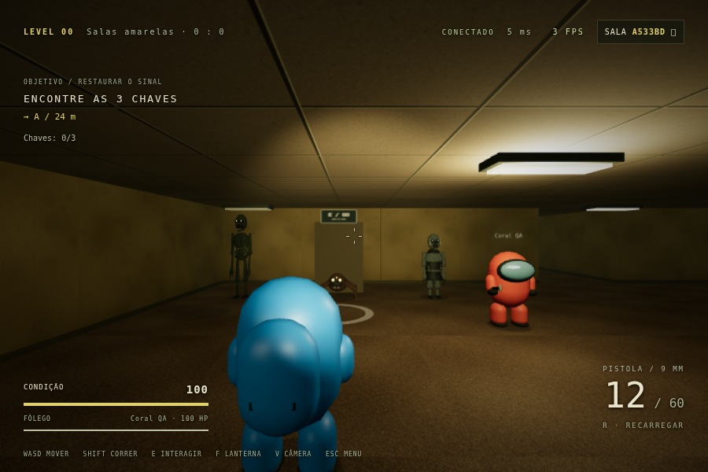
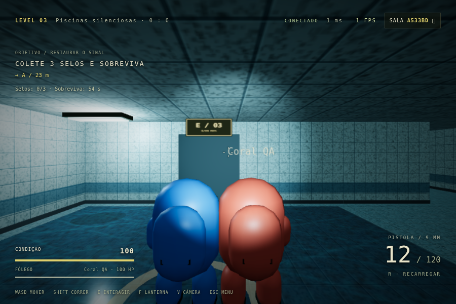

# Atualização — Backrooms ECHO 1.1.0

Esta é uma evolução da versão revisada 1.0.1. O código modular existente foi
editado; o Level 0 mantém sua geração, colisão e regras de movimento. A arma,
áudio, lobby, duas pessoas, reconexão, suprimentos, reanimação e opções gráficas
foram conservados. O protótipo Python permanece em `original/`.

## Alterações

- Explorador original de cápsula: visor de vidro, mochila, botas/pernas curtas,
  braços, caminhada, inclinação na corrida e cor escolhida no lobby. A constante
  padrão está no topo de `shared/config.js`. **V** alterna a câmera; a câmera
  em terceira pessoa recua respeitando paredes e teto.
- Os três tipos de criatura mantêm IA/estatísticas base e receberam modelos
  articulados, mandíbulas, dentes/garras/costelas, materiais orgânicos, olhos
  luminosos, animações por estado, dano e morte. Pools reaproveitam os rigs.
- Quatro níveis: chaves amarelas, geradores no depósito, fusíveis nos túneis
  e selos nas piscinas. Cada um tem texturas, paleta, neblina, iluminação e
  dificuldade próprias. No último, a saída exige também 60 segundos de
  sobrevivência desde a entrada. O HUD mostra progresso e tempo restante.
- Portas bloqueadas, conclusão compartilhada, botão de avanço do host,
  carregamento coordenado, vitória final e reinício no Level 0. A transição
  pausa a simulação e preserva a identidade e o inventário dos jogadores.
- O tiro parte da ponta mundial do cano em direção ao alvo da mira. Flash,
  projétil visual/rastro, recuo, impacto, som, HUD de munição e R para recarga
  foram integrados. Dano e obstáculos continuam validados pelo servidor.
- Contador de FPS no canto superior direito e diagnóstico somente leitura.
- Arquivo completo `Backrooms-ECHO-Completo.cjs`, além das fontes modulares,
  iniciar.bat e portátil Windows com servidor embutido.

## O que pesava ao andar

Na versão anterior, cruzar uma fronteira criava três setores no mesmo quadro
(até nove no carregamento inicial), incluindo geometrias de manchas/caixas,
materiais de cada luminária e buffers novos. Os setores descartados precisavam
ser reconstruídos ao voltar. A seleção de lâmpadas criava e ordenava listas a
cada quadro, com muitas luminárias renderizadas separadamente. A previsão de
movimento usava o tempo limitado da animação; em frames muito lentos ficava
atrasada em relação ao servidor e a correção da posição podia parecer um salto.
São causas encontradas no código; sem medir o PC do jogador não dá para
atribuir todo travamento a apenas uma delas.

Agora há 16 setores reutilizáveis, montagem de **no máximo um por quadro**,
antecipação perto das fronteiras, culling e InstancedMesh para paredes,
luminárias, manchas, canos e vigas. Texturas/geometrias/materiais são
compartilhados, e lâmpadas próximas são escolhidas a cada 200 ms. O ambiente
usa no máximo quatro luzes sem sombra; apenas a lanterna faz sombra na
qualidade Alta, com atualização limitada. O pixel ratio continua limitado a
1,5. A física local usa passos fixos, entradas seguem a 20 Hz independentemente
da renderização e projéteis/marcas/entidades são reaproveitados.

## Medição reproduzível

Uma caminhada de aproximadamente 51–52 metros cruzou a mesma fronteira, com
a mesma seed, resolução 480×320, qualidade Leve, sem monstros. Execuções
sequenciais em Chromium/WebGL por software, sem outra tarefa gráfica. Estes
números são dessa execução, não uma promessa de FPS em qualquer computador.

| Medida | 1.0.1 | 1.1.0 |
|---|---:|---:|
| Chamadas reais de desenho, mediana | 130 | 64 |
| Setores montados no mesmo quadro, máximo | 3 | 1 |
| Custo máximo de montagem de um setor | 1.3 ms | 0.3 ms |
| Tempo de quadro, percentil 95 | 250 ms | 133.3 ms |
| Tempo de quadro, mediana | 50 ms | 66.7 ms |

A mediana de chamadas de desenho caiu cerca de 51%. O percentil 95 ficou
menor nessa execução; a mediana de tempo de quadro oscilou e não houve uma
melhoria uniforme em todas as medidas. Não há validação de desempenho em GPU
física neste ambiente. Use o contador para conferir seu PC; qualidade Leve e
janela menor continuam disponíveis. Dados brutos: `performance-before.json`
e `performance-after.json`. Teste: `npm run test:performance`.

## Bugs encontrados e tratados

- O disparo anterior calculava dano a partir da câmera, com origem/clarão
  aproximados; não havia projétil visível viajando desde a ponta do cano.
  A origem agora acompanha a transformação real da arma, converge na mira
  e é validada contra paredes. As câmeras do mundo e da arma têm FOVs
  diferentes; a conversão também corrige essa diferença.
- Movimento previsto e envio de intenções dependiam da cadência de desenho,
  favorecendo divergências em FPS baixo. Relógios/física foram separados.
- Enviar pacotes quando um WebSocket já estava fechando podia registrar erro.
  As intenções agora verificam o estado do transporte antes de enviar.
- Enumerar interfaces de rede podia falhar em um ambiente restrito e causar
  erro 500 em `/api/info`. A consulta agora tolera essa condição.
- Na validação da campanha, uma fixture copiava o identificador da chave para
  o jogador e quebrava sua identificação no cliente. A fixture foi corrigida;
  não era uma alteração executada pelo jogo entregue.

Os marcos da campanha também usam eventos confiáveis, além dos snapshots,
para entregar a mesma transição aos dois clientes. Correções da revisão 1.0.1,
incluindo cursor no reinício, patrulha e pausa quando o host desconecta,
continuam no código e nos testes.

## Conferência visual

Cena de inspeção dos três modelos e exploradores, com IA congelada apenas no teste:

Level 3 com água rasa e iluminação azul:

Controles anteriores foram mantidos. Novidade de teclado: **V**. Cor: lobby.
Os testes e limites da compilação estão em `TESTES.md`.
